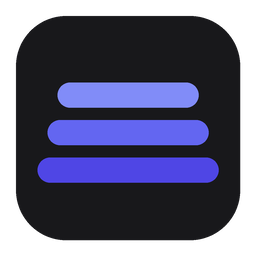
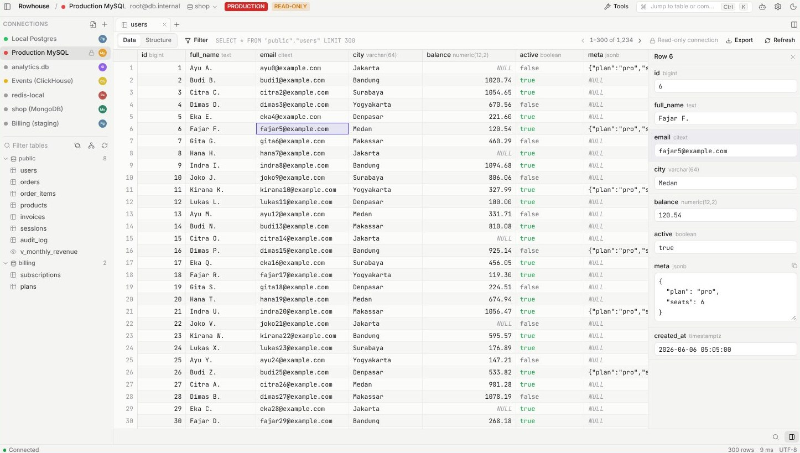
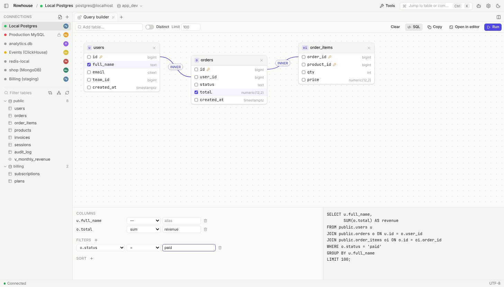
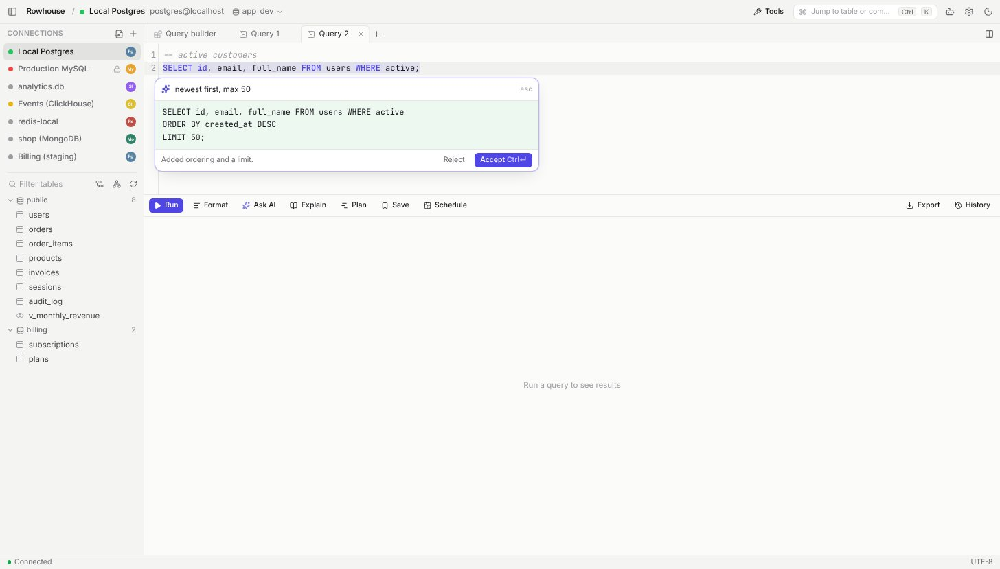
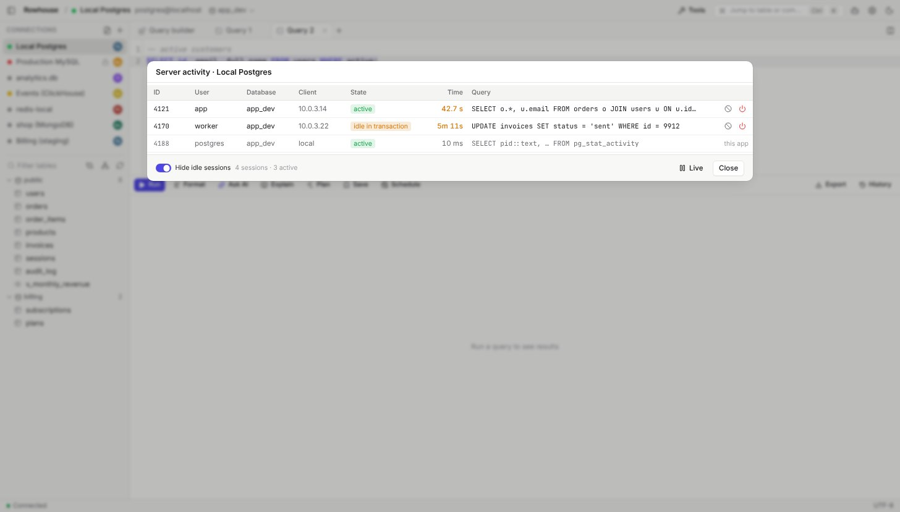

# Rowhouse

A fast, compact, open-source database client for macOS, Windows and Linux. One window for Postgres, MySQL, SQLite and 20+ more — with an AI copilot and a read-only **MCP server** built in, so Claude and other assistants can explore your data through the same connections you already use.

Rowhouse is built with Tauri 2 (Rust engine, React UI) — a small native download over a Rust core, not an Electron shell. The UI is a compact 12–13px, keyboard-first, and quick enough to disappear.



| Visual query builder | AI inline edit |
|---|---|
|  |  |

| Server activity |
|---|
|  |

## Features

### Connect

- Connection manager — passwords live in the OS keychain (Keychain / Credential Manager), never in a plaintext file.
- Per-connection **read-only** mode and color tags (e.g. red = production).
- **SSH tunnels** — private key (incl. encrypted), SSH agent (1Password / Pageant / Windows OpenSSH) or password; host key checked against `~/.ssh/known_hosts`, otherwise pinned on first connect.
- **TLS** — disable / prefer / require / verify-ca / verify-full, with custom CA and client certificates (mutual TLS).
- Paste a connection URL (`postgresql://…`, `mysql://…`, `mongodb+srv://…`); Neon and Supabase are recognised and use TLS by default.
- Import connections from **DBeaver, TablePlus and Navicat** (auto-detected; passwords re-entered once).
- Auto-reconnect after the machine wakes from sleep.
- **Folder sync** (Pro) — connections, saved queries and dashboards follow you across machines through a folder you already sync (iCloud Drive, Dropbox, OneDrive, Syncthing). One file, encrypted with your passphrase (PBKDF2 + AES-256-GCM); no Rowhouse server.

### Browse & edit

- Schema tree with filter; table **Data** / **Structure** views.
- Functions, procedures, triggers, sequences, enum types and materialized views in the tree — click one to open its definition in a query tab.
- Right-click a table: **Show DDL**, rename, duplicate (with or without rows), truncate, drop (typed confirmation), export, generate data. A **new-table designer** previews the CREATE TABLE as you go.
- **Foreign keys are links** — open the referenced row from a cell, or jump to the rows that reference this one.
- Virtualized result grid — sort, resize columns, keyboard navigation, `⌘/Ctrl+C` copies a cell.
- **Inline editing** for tables with a primary key — edit / NULL / add / delete rows, review the generated SQL, commit atomically (`⌘/Ctrl+S`). Every UPDATE/DELETE must hit exactly one row or the transaction rolls back.
- **Range selection + bulk ops** — set value / NULL, duplicate, delete, paste from a spreadsheet, copy as CSV / JSON / Markdown / INSERT.
- **Row details** panel with a JSON editor, and **find in results**.
- Table structure editor (add / rename / change / drop columns, DDL previewed first) and **index / foreign-key editing**.
- Export query or table results to **CSV, JSON or SQL INSERTs** (streamed, no row limit); import CSV into a table in one transaction.
- **Dummy data** — realistic rows per column (names, emails, dates, numbers, JSON…), guessed from names and types; foreign-key columns pick values that exist.

### Query

- SQL editor (CodeMirror 6) — dialect-aware highlighting, table autocomplete, `⌘/Ctrl+↵` runs the selection or whole script; multi-statement scripts return multiple result sets.
- **SQL formatter** and a **database switcher** to jump between databases on a connection.
- **Dashboards** — pin a chart from any query, or build tiles from saved queries: charts, tables and big numbers on a grid, drag to reorder, auto-refresh. Tiles always run read-only and follow their saved query. Global filters (`:from`, `{{region}}`) apply to every tile, and scheduled snapshots save a PNG to a folder every day/week/N minutes, with a notification.
- **Charts** — bar, line, area or scatter from any result, with hover tooltips; copy or save as PNG / SVG.
- **Query variables** — `:name` (quoted for you) and `{{name}}` (pasted as typed) are asked for before the query runs.
- **Run SQL files** — big seed files and migrations run statement by statement with progress, stop or keep going at errors (MySQL `DELIMITER` and Postgres `$$` bodies handled).
- **Visual query builder** — drop tables on a canvas, foreign keys join themselves, drag to join, add filters and aggregates, live SQL beside it.
- **Query plan viewer** — EXPLAIN as a tree with cost/time bars and hints (full scans, bad estimates, disk sorts); `ANALYZE` on Postgres runs read-only.
- **Saved queries** and **query history** (`⌘/Ctrl+Y`), per connection or global — shared with the MCP server, so queries an assistant runs show up tagged “AI”.
- **Cancel running queries** (server-side on Postgres/MySQL), per-query **timeout**, and tabs restored after restart.
- **Scheduled queries** — interval / daily / weekly, export to CSV/JSON, notify on failure or when results change.
- Split panes (`⌘/Ctrl+\`) with drag-and-drop tabs between them.

### AI copilot (bring your own model)

- **Ask AI** (`⌘/Ctrl+I`) turns a sentence into SQL; **Fix with AI** on errors; **Explain** a query.
- **Inline edit** (`Mod+I` in the editor) rewrites the selection or generates at the cursor; **streaming** responses and **inline completions** as you type.
- Proposals are shown as a **diff** and only applied when you accept.
- Works with OpenAI-compatible APIs (OpenAI, OpenRouter, Ollama, LM Studio, …) and Anthropic.
- **Uses what's already on your machine** — Claude Code, Codex, OpenCode, Gemini CLI, Cursor Agent and Copilot CLI are detected and run headless with your existing login (no API key), and Ollama / LM Studio are found on their default ports.
- Only the schema (names / types) and your SQL are sent — **never rows**.

### Visualize & compare

- **ER diagram** — built from foreign keys; pan / zoom / drag, click to focus a table's relations, double-click to open it, export SVG.
- **Schema compare** between any two connections or schemas, with a migration script for the target (drops commented out).
- **Data compare** — PK-matched rows with a sync script.
- **Backup / restore** — `pg_dump` / `pg_restore` / `psql`, `mysqldump` / `mysql`, SQLite `VACUUM INTO`.
- **Server activity** — see what's running, cancel a runaway query or kill a stuck session.
- **Users & roles** — see who can do what, create users, grant / revoke, change passwords (PostgreSQL, MySQL/MariaDB, SQL Server); every change shows its SQL first.

### Safety

- Tag connections **Local / Dev / Staging / Production** — production starts read-only, gets a red window frame, and every DROP / TRUNCATE / DELETE or UPDATE without a WHERE asks you to type the table name first.
- Command palette (`⌘/Ctrl+K`), light / dark theme, and a compact or comfortable density (Settings › Appearance).

### Extensions

- Small web apps that run in a sandboxed panel and use the `window.rowhouse` API — schema, queries (read-only unless granted), results, toasts. Users approve each extension's permissions; network access is limited to the hosts it declares.
- Install from a folder or a `.rhext` file (Tools › Extensions). Guide and examples: [docs/EXTENSIONS.md](docs/EXTENSIONS.md), [extensions/examples](extensions/examples).

## Databases

| Status | Databases | How |
| --- | --- | --- |
| ✅ integration-tested | PostgreSQL (incl. TLS / mTLS), Redis (incl. TLS), MySQL / MariaDB, SQLite, DuckDB, ClickHouse | `sqlx`, `duckdb` (embedded), ClickHouse HTTP API |
| ✅ tested against a protocol-level fake backed by real SQLite | Turso / libSQL (Hrana HTTP), Cloudflare D1 (REST API) | `reqwest` |
| 🧪 tests wired into CI (verify on first run) | SQL Server, CockroachDB, MySQL 8, MongoDB (beta), Cassandra / ScyllaDB (beta), Oracle (beta), Elasticsearch / OpenSearch (beta), BigQuery (beta, emulator + fake REST server), Snowflake (beta, fake SQL API server) | `tiberius`, Postgres protocol, official `mongodb` driver, `scylla` (CQL), `oracle` (ODPI-C), SQL REST APIs |
| 🟡 beta (wire-compatible, not yet run against a live server) | Neon, Supabase (Postgres + TLS), Amazon Redshift, Greenplum, TiDB, SingleStore | Postgres / MySQL protocol |

- **MongoDB** — collections are tables; the editor takes mongosh-style statements (`db.orders.find({ status: 'paid' }).sort({ total: -1 }).limit(10)`, `aggregate([...])`, `insertOne`, `updateMany`, `show collections`, …). Grid edits are keyed by `_id`, keep each field's BSON type, and are checked up front (not transactional — MongoDB needs a replica set for that). Paste a `mongodb://` / `mongodb+srv://` URI to connect to Atlas.
- **Turso / Cloudflare D1** — SQLite dialect over HTTPS. D1 needs a Cloudflare API token with D1 permissions; a multi-statement request runs as one transaction.
- **Cassandra / ScyllaDB** — speak CQL, keyspaces show up as schemas. Grid edits go through `fromJson()`, so uuid, timestamp and collection columns just work; keyed UPDATE/DELETE use `IF EXISTS`. CQL has no transactions.
- **Oracle** — needs Oracle Instant Client (“Basic Light”, free download) at runtime; Rowhouse finds it in the usual folders or the one you pick on the connection. Schemas are users; PL/SQL blocks run when they end with a `/` line, and dates read and write as ISO text.
- **Elasticsearch / OpenSearch** — indices and aliases are tables, nested fields are flattened (`address.city`). SQL there is read-only, so grid editing is off — but the editor also takes Kibana Dev Tools requests (`GET /orders/_search` with a JSON body, `POST /orders/_doc`, `GET _cat/indices`), and search hits and aggregations come back as tables. `DELETE /index` asks for confirmation, and read-only connections only allow searches; leave the user empty to sign in with an API key, or put a full `https://…` URL in the host for Elastic Cloud.
- **Snowflake** — SQL API v2 with key-pair auth (an unencrypted PKCS#8 `.p8` key) or a programmatic access token; set the warehouse and role on the connection. Grid edits run as one Snowflake Scripting block that checks `SQLROWCOUNT` and rolls back on a mismatch.
- **BigQuery** — pick a service-account key file (or paste a `gcloud auth print-access-token` token); datasets show up as schemas. Grid edits run as one multi-statement transaction with `ASSERT @@row_count` checks, so a key that matches the wrong number of rows rolls everything back. Every query is billed by BigQuery as usual.
- **ClickHouse** has no transactions, so grid editing is disabled there (CSV import still works). **SQL Server** connections encrypt and accept self-signed certificates, like most DB GUIs.

## MCP

`rowhouse-mcp` is a stdio MCP server bundled with the app. It reads the same connections as Rowhouse and only exposes profiles with **“Expose to AI assistants via MCP”** enabled.

| Tool | What it does |
|---|---|
| `list_connections` | Saved connections visible to MCP |
| `list_tables` | Tables & views |
| `describe_table` | Columns, types, nullability, defaults, PK |
| `sample_rows` | First N rows of a table |
| `search_schema` | Find tables / columns by name on large databases |
| `get_relations` · `get_ddl` | Foreign keys in and out of a table; its CREATE statement |
| `list_objects` · `get_object_definition` | Functions, procedures, triggers, sequences, enum types, materialized views |
| `explain_query` | Query plan as a tree (`analyze` only for reads) |
| `table_stats` | Approximate row counts and sizes from the database's statistics |
| `list_saved_queries` · `run_saved_query` · `recent_queries` | The user's saved queries and history |
| `run_query` | Read-only SQL (SELECT / WITH / SHOW / EXPLAIN); read commands for Redis, find/aggregate for MongoDB |
| `execute_sql` | A write — only after you approve it in Rowhouse (connections with “Allow AI to request writes”) |

Every MCP query passes a keyword guard **and** runs inside a read-only transaction (`BEGIN READ ONLY` on Postgres, `START TRANSACTION READ ONLY` on MySQL, `PRAGMA query_only` on SQLite). Writes always wait for your approval in the app; destructive ones need the table name typed.

**One click:** *Connect an AI assistant* in the app adds Rowhouse to Claude Desktop, Claude Code, Cursor, Windsurf, VS Code, Codex, OpenCode and Gemini CLI (keeps your other servers, leaves a `.bak`). Or point any MCP client at the bundled binary:

```json
{ "mcpServers": { "rowhouse": { "command": "/absolute/path/to/target/release/rowhouse-mcp" } } }
```

Profiles file (override with `ROWHOUSE_CONFIG_DIR`):

- macOS: `~/Library/Application Support/id.novagen.rowhouse/connections.json`
- Windows: `%APPDATA%\novagen\rowhouse\config\connections.json`
- Linux: `~/.config/rowhouse/connections.json`

## Install

Download the installer for your platform from [Releases](../../releases/latest):

| Platform | File |
|---|---|
| macOS (universal) | `Rowhouse_<version>_universal.dmg` |
| Windows | `Rowhouse_<version>_x64-setup.exe` or `_x64_en-US.msi` |
| Linux | `.AppImage`, `.deb` or `.rpm` |

The builds are not yet code-signed. On macOS, right-click the app and choose **Open** on first launch, or run:

```bash
xattr -dr com.apple.quarantine /Applications/Rowhouse.app
```

## Build

Prerequisites: Rust (stable), Node 20+, pnpm 10, plus the [Tauri prerequisites](https://v2.tauri.app/start/prerequisites/) (Xcode CLT on macOS; WebView2 + MSVC build tools on Windows).

```bash
pnpm install          # also installs git hooks (husky)
pnpm dev              # desktop app with hot reload
pnpm dev:ui           # UI only in the browser, backed by a mock API (fast design loop)
pnpm test             # cargo test --workspace
pnpm build            # release MCP binary + installers (.dmg/.app, .msi/.exe, Linux packages)
```

The first build compiles DuckDB from source and takes a while; later builds are cached.

```
crates/rowhouse-core   Rust engine: drivers, connection store, read-only guard
crates/rowhouse-mcp    MCP server binary (rmcp, stdio)
apps/desktop           Tauri 2 app — React + Tailwind v4 UI in src/, Rust shell in src-tauri/
```

Commits follow [Conventional Commits](https://www.conventionalcommits.org), enforced by commitlint. CI runs tests on Linux and builds installers on macOS, Windows and Linux for every `v*` tag — see [RELEASING.md](RELEASING.md).

## How it works

- **Query execution** goes through `sqlx::raw_sql` (simple/text protocol), so any column type can be displayed and multi-statement scripts work. Values become JSON — numbers, booleans and JSON stay typed, everything else is a string, and NUMERIC stays a string to keep precision.
- **Read-only guard** — reads pass a keyword check *and* run in a read-only transaction, so an AI assistant can never reach a write path by accident.
- **Backends** beyond Postgres/MySQL/SQLite live in `crates/rowhouse-core/src/backend/` (ClickHouse, DuckDB, MongoDB, Redis, Cassandra/Scylla, libSQL/Turso, Cloudflare D1, SQL Server), each behind the same driver interface.
- **AI** only ever sees schema names/types and the SQL you wrote — rows never leave the machine.

## License

MIT — see [LICENSE](LICENSE). © Rowhouse / [Novagen](https://www.novagen.id/).
